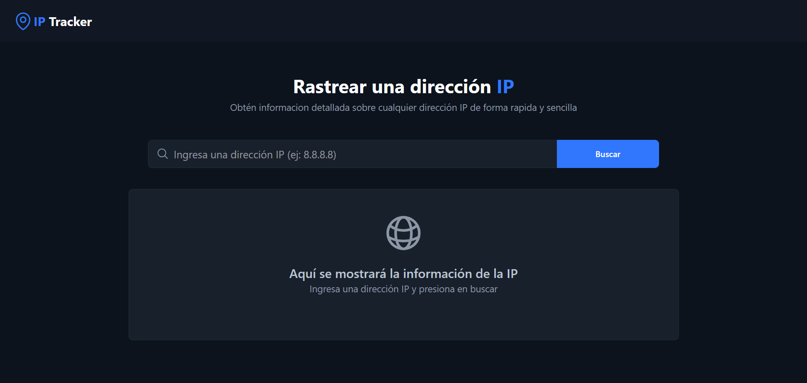
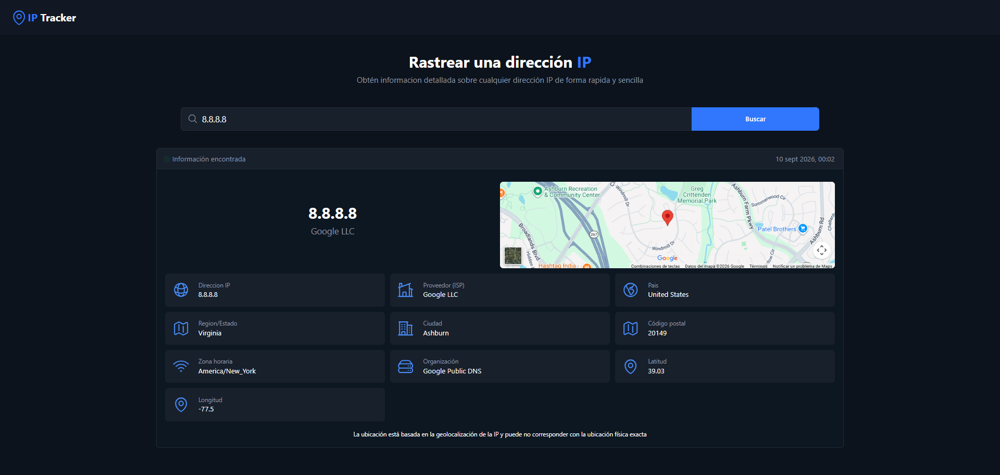
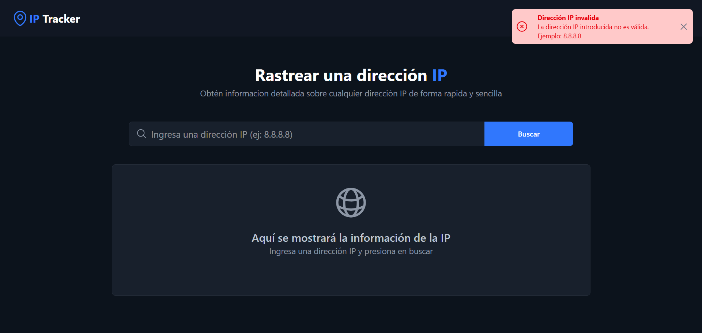

# IP Tracker

Aplicación web para consultar información geográfica y de red asociada a una dirección IP. Los resultados se presentan en una interfaz responsive e incluyen un mapa con la ubicación aproximada.



## Funcionalidades

- Búsqueda de direcciones IPv4.
- Consulta de país, región, ciudad y código postal.
- Información del proveedor de Internet (ISP) y de la organización, cuando está disponible.
- Visualización de zona horaria, latitud y longitud.
- Mapa integrado con la ubicación aproximada de la IP.
- Notificaciones para búsquedas no válidas o errores de conexión.
- Diseño adaptable a dispositivos móviles y pantallas de escritorio.

## Tecnologías

- HTML5
- JavaScript
- Tailwind CSS 4 mediante Tailwind CLI
- npm para la gestión de dependencias y scripts
- CSS personalizado
- [ipapi.co](https://ipapi.co/api/) mediante HTTPS para obtener los datos de la dirección IP
- Google Maps Embed para mostrar la ubicación

## Estructura del proyecto

```text
iptracker/
├── css/
│   ├── styles.css
│   └── output.css
├── js/
│   └── app.js
├── docs/
│   └── screenshots/
├── .gitignore
├── index.html
├── package.json
├── package-lock.json
└── README.md
```

## Puesta en marcha

### Requisitos

- Node.js y npm
- Un servidor web local, como Live Server o Python

### Instalación

Clona el repositorio e instala las dependencias:

```bash
git clone https://github.com/Ale2484/IpTracker
cd IpTracker
npm install
```

### Desarrollo

Inicia Tailwind CSS en modo observación para regenerar `css/output.css` cada vez que cambien las clases del HTML, JavaScript o CSS:

```bash
npm run dev
```

Este comando compila los estilos, pero no inicia un servidor web. En otra terminal, ejecuta:

```bash
python3 -m http.server 8000
```

Después, abre `http://localhost:8000` en el navegador. También puedes utilizar una extensión como Live Server.

El archivo `js/app.js` se carga mediante `defer`, por lo que el navegador puede procesar el HTML antes de ejecutar el código JavaScript.

## Uso

1. Escribe una dirección IP en el buscador, por ejemplo `8.8.8.8`.
2. Pulsa **Buscar**.
3. Consulta los datos obtenidos y la ubicación aproximada en el mapa.

## Capturas

La pantalla de resultados reúne la información geográfica y de red de la dirección IP consultada junto a un mapa de su ubicación aproximada.



Cuando la dirección introducida no es válida o la consulta no puede completarse, la aplicación muestra una notificación de error.



## GitHub Pages

La consulta utiliza `https://ipapi.co/{ip}/json/`, compatible con páginas HTTPS como GitHub Pages. El endpoint gratuito de IP-API (`http://ip-api.com`) no admite HTTPS y el navegador bloquea su uso desde una página HTTPS por contenido mixto.

ipapi.co aplica límites de uso; si se supera la cuota o falla el servicio, se muestra un error de consulta. El proveedor devuelve la organización de red (`org`), que se utiliza también como información del proveedor (ISP).

## Consideraciones

- La geolocalización de una IP es aproximada y no representa necesariamente la ubicación física exacta del dispositivo.
- La disponibilidad y precisión de algunos campos dependen de los datos proporcionados por la API.

## Autor

Desarrollado por [Ale2484](https://github.com/Ale2484).

## Licencia

**Propietario - Todos los derechos reservados.**

El codigo fuente se publica unicamente con fines de consulta y referencia.
No se concede permiso para usarlo, copiarlo, modificarlo, distribuirlo ni
incorporarlo en otros proyectos sin autorizacion previa y por escrito del autor.

Para consultas sobre licencias, contacta conmigo.
